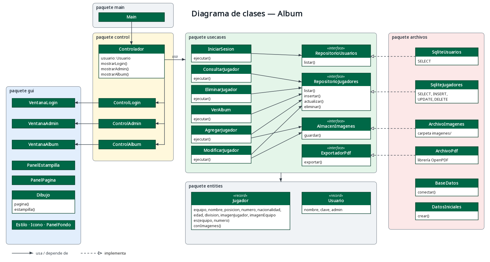
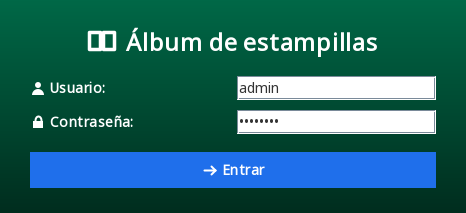
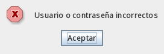
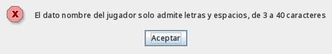
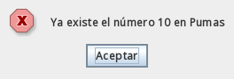
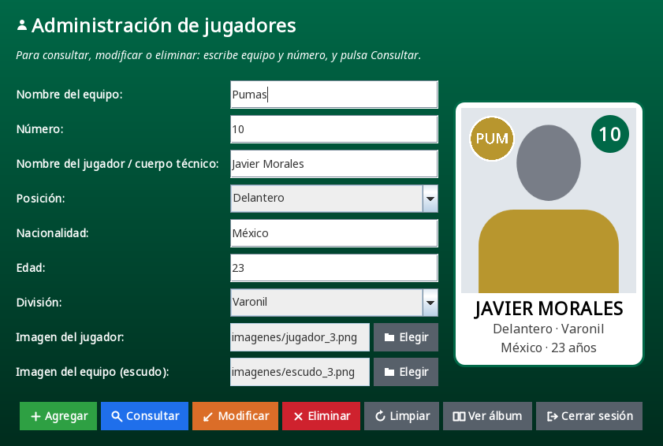
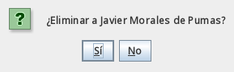
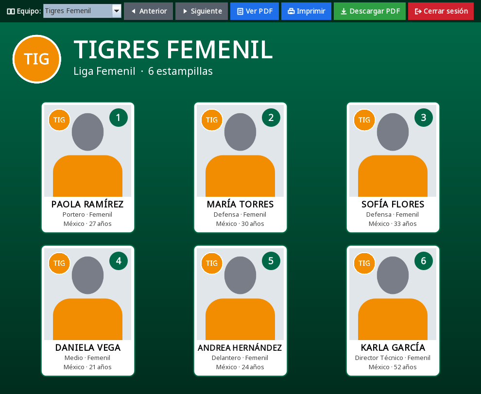
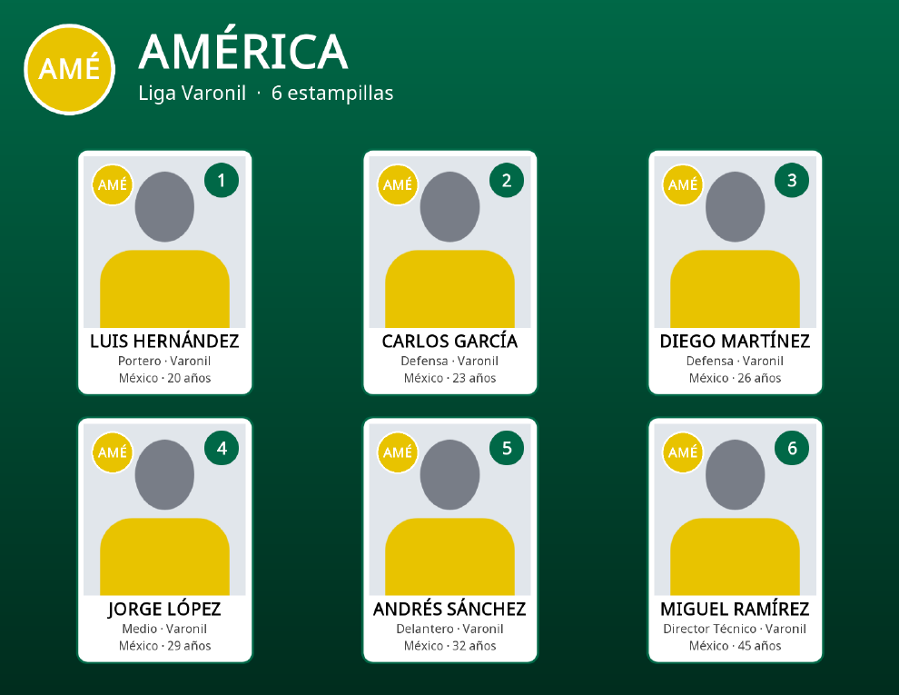

# Album

## Álbum de estampillas de futbol

**Paradigmas de Programación I — Segunda evaluación 2026B**
ICO, Grupo C4 · CU UAEM Tianguistenco

**Equipo 5:** Rivera Salinas Billy
**No. de cuenta:** ________
**Docente:** M.C.C. Maritza Flores Domínguez
**Fecha:** 17 de noviembre de 2026

---

## Índice

1. Introducción
2. Problemática
3. Objetivos
4. Alcances
5. Delimitaciones
6. Estructura del sistema
7. Diagrama de clases
8. Funcionamiento del sistema
9. Conclusiones

---

## 1. Introducción

**Album** es una aplicación de escritorio hecha en Java que funciona como un álbum de estampillas de futbol de la Liga MX, varonil y femenil.

- Cada jugador o integrante del cuerpo técnico es una estampilla con su foto, escudo, número, posición, nacionalidad, edad y división.
- El administrador registra y mantiene las estampillas.
- El usuario común hojea el álbum equipo por equipo y lo obtiene en PDF.
- Toda la interfaz está construida a puro código con Swing.

---

## 2. Problemática

Un álbum de estampillas en papel tiene límites claros:

- Una estampilla mal impresa o con un dato equivocado no se puede corregir.
- Agregar un jugador nuevo o un equipo completo obliga a rehacer hojas.
- No hay forma rápida de buscar a un jugador por equipo y número.
- Compartir el álbum significa prestarlo o fotocopiarlo.

Se necesita un álbum digital donde la información se pueda agregar, consultar, modificar y eliminar, con acceso distinto para quien lo administra y para quien solo lo consulta.

---

## 3. Objetivos

**Objetivo general**

Desarrollar una aplicación de escritorio en Java que administre un álbum de estampillas de futbol, con control de acceso por tipo de usuario y salida en PDF.

**Objetivos específicos**

- Registrar, consultar, modificar y eliminar jugadores y cuerpo técnico (CRUD).
- Validar los datos capturados y avisar con mensajes emergentes.
- Guardar la información en una base de datos SQLite.
- Mostrar el álbum por equipo en forma de estampillas.
- Generar el álbum en PDF para verlo, imprimirlo y descargarlo.
- Separar el sistema en paquetes con una sola responsabilidad cada uno.

---

## 4. Alcances

- Dos tipos de usuario con inicio de sesión: administrador y usuario común.
- CRUD completo de jugadores, buscando por equipo y número.
- Validaciones: campos obligatorios, solo letras y longitud en nombres, números enteros y rangos en número y edad, resolución de las imágenes, jugadores no repetidos y máximo de integrantes por equipo.
- Mensajes emergentes al guardar, modificar, eliminar y ante cualquier error.
- Álbum con una hoja por equipo; la cuadrícula se acomoda sola según la cantidad de estampillas.
- PDF del álbum: ver, imprimir y descargar.
- 10 equipos de ejemplo: 5 de la liga varonil y 5 de la femenil.

---

## 5. Delimitaciones

- Es una aplicación de escritorio para un solo equipo de cómputo; no funciona en red ni en web.
- Los usuarios son fijos (un administrador y un usuario común); no hay pantalla para dar de alta más.
- Las contraseñas se guardan sin cifrar.
- Los equipos no se registran por separado: existen a partir de sus jugadores.
- Los nombres de equipo, jugador y nacionalidad solo admiten letras y espacios.
- Los datos de ejemplo usan nombres inventados y siluetas genéricas en lugar de fotos reales.

---

## 6. Estructura del sistema

Las dependencias van siempre hacia adentro: lo de afuera conoce a lo de adentro, nunca al revés.

| Paquete    | Responsabilidad                                                              |
|------------|------------------------------------------------------------------------------|
| `gui`      | Ventanas, paneles, estilos e iconos. Solo diseño, a puro código               |
| `control`  | Eventos de cada ventana; da la funcionalidad a los componentes                |
| `usecases` | Las acciones del sistema y sus reglas, una clase por acción                   |
| `entities` | Los datos: `Jugador` y `Usuario`, que validan su propia información           |
| `archivos` | Conexión a la base de datos, operaciones DML, imágenes y generación del PDF   |
| `main`     | Crea el controlador y arranca el programa                                     |

---

## 7. Diagrama de clases

---

## 8. Funcionamiento: inicio de sesión

- `admin` entra a la administración de jugadores.
- `usuario` entra directo al álbum.
- Con datos incorrectos aparece un mensaje y no se permite el acceso:

---

## 8. Funcionamiento: consultar

Se escribe el equipo y el número, y el sistema carga los datos y la estampilla.

---

## 8. Funcionamiento: validaciones

Antes de guardar se revisa cada dato. Si algo está mal, no se guarda y se avisa:

---

## 8. Funcionamiento: agregar

---

## 8. Funcionamiento: modificar

Se consulta al jugador, se cambian los datos (aquí posición y edad) y se pulsa Modificar.

---

## 8. Funcionamiento: eliminar

El sistema pide confirmación antes de borrar.

---

## 8. Funcionamiento: álbum

Una hoja por equipo. El usuario común solo puede ver el álbum y obtener el PDF.

---

## 8. Funcionamiento: PDF

El mismo álbum se puede ver, imprimir y descargar en PDF, con una hoja por equipo.

---

## 9. Conclusiones

- El sistema cumple con lo solicitado: interfaz a puro código, CRUD completo, validaciones con mensajes emergentes, control de acceso y álbum en PDF.
- Separar el sistema en paquetes con una sola responsabilidad permitió cambiar el almacenamiento de archivos de texto a SQLite, y la generación del PDF, sin tocar las ventanas ni las reglas del sistema.
- Poner las validaciones dentro de `Jugador` garantiza que ningún dato inválido llegue a la base de datos, sin importar desde dónde se capture.
- Dibujar las estampillas con una sola rutina hace que la pantalla, el PDF y la impresión se vean iguales.
- Como trabajo futuro quedan: un listado de jugadores en tabla, administración de usuarios y cifrado de contraseñas.

---

# Gracias

## ¿Preguntas?
